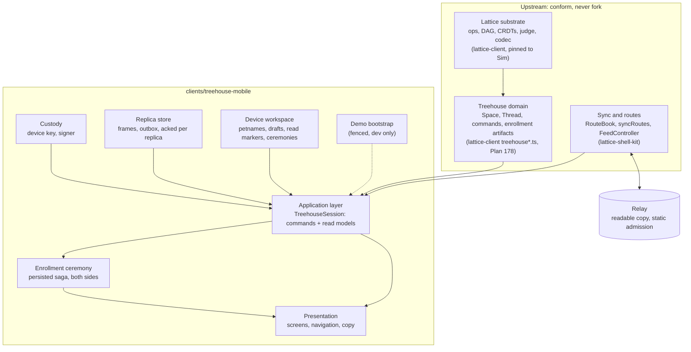

# 2. Domain and bounded contexts

## The core idea

The app holds no mutable group state. A Group is a set of signed operations. The app does two
things with them:

1. **Derive**: run the shared reducer and judge over the held ops to get the current view.
2. **Author**: sign one new command op that cites a grant and the current frontier, save it,
   and let sync carry it.

So the aggregates are the replicas themselves (one Space, many Threads), and their invariants
are enforced by `lattice-client`, which is pinned to `Lattice.Sim`. The app's own modelling
work is everything around that: which facts are group truth, which are relay observations and
which are private to this phone.

## Three kinds of facts

| Kind | Examples | Source of truth | Survives reinstall? | Shared? |
|---|---|---|---|---|
| **Signed shared** | messages, members, roles, invitations, archive flag, quarantine verdicts | held ops, reduced by `lattice-client` | only if re-pulled from the relay or another copy | yes |
| **Relay link** | acked ids, generation, refused ids, connection state | this device's last exchange with one relay | no (acked ids are saved, the rest is live) | no |
| **Device local** | petnames, drafts, read markers, first-seen times, ceremony progress, settings | this phone's local store | no | no |

Rules that follow:

- A read model may join the three kinds, but each field keeps its kind. `ThreadTimeline` joins
  message text (signed), delivery state (relay link) and first-seen time (local).
- Nothing device-local or relay-link ever feeds the judge or a signed op.
- The UI never shows a relay-link fact as a group fact. "On relay" is not "delivered".
- Petnames are local on purpose. A shared display name would need a new signed command, and
  the vocabulary is frozen.

## Context map

| Context | Owns | Relationship | Code home |
|---|---|---|---|
| Lattice substrate | op model, DAG, reducers, authority judge, canonical bytes | Upstream. Conformist. | `clients/lattice-client/src` |
| Treehouse domain | Space and Thread schemas, command table, invitation review, capability selection | Upstream. Conformist. Frozen by Plan 178. | `clients/lattice-client/src/treehouse*.ts` |
| Sync and routes | route validation, pull, submit, acks, availability feed | Upstream. The app implements its `ShellHost` port. | `clients/lattice-shell-kit/src` |
| Custody | the device key, any per-Thread root keys this phone created, and their signing functions | App-owned adapter behind a port. Keys never leave it. | `src/native/custody.ts` |
| Replica store | held frames, outbox and acked ids per replica | App-owned adapter. Append-only. | `src/native/storage.ts` |
| Device workspace | all device-local facts | App-owned. Separate tables from the replica store. | to build: `src/local/` |
| Application layer | one session per identity and Group; typed commands; read models | App-owned. The only thing the UI imports. | to build: `src/session/` (see note) |
| Enrollment ceremony | the multi-step invite and join, saved between steps | App-owned saga on top of the application layer. | to build: `src/ceremony/` |
| Presentation | screens, navigation, strings | Depends on application layer only. | to build: `src/screens/`, `src/ui/` |
| Demo bootstrap | endpoints manifest, demo seeds, role switcher | Anti-corruption layer. Dev builds only. The testbed serves the demo seeds to anyone, so a demo identity proves nothing about who wrote a message; demo screens say so. | `src/demo/` (move out of the host) |

Note on folders: `clients/treehouse-mobile/AGENTS.md` reserves `src/app/` for Expo Router
routes, so the application layer lives in `src/session/`. `expo-router` is not installed yet;
M0 is a single `src/App.tsx` (open decision O-3).

## Entities and value objects the app defines

The domain entities (Space, Thread, Post, Invitation, Grant) already exist upstream as reduced
state. The app adds only these:

| Name | Kind | Identity | Notes |
|---|---|---|---|
| `DeviceIdentity` | entity | public key | One per install. Its transport realm is assigned by the admin and arrives in the offer (`localRealm`). |
| `ThreadKey` | entity | thread nonce | Root key of a bounded Thread this phone created. Signs that Thread's grants to new members. Held only on the creating phone. |
| `Contact` | entity | public key | Petname, first-met date, verified-in-person flag. Local. |
| `HeldReplica` | entity | replica id | Frames, outbox, acked. Mirrors shell-kit `HeldProfile`. |
| `Route` | value | replica id | URL, expected relay realm and key. Validated by shell-kit. |
| `Ceremony` | entity | local id | Role (admin or joiner), step, the artifacts so far. |
| `Draft` | value | thread id | Text and, for an edit, the target message id. |
| `ReadMarker` | value | thread id | Set of message ids shown, stored compactly. |
| `MessageRef` | value | post id | Root post id plus latest edit id in its lineage (`author_edit` needs both). |
| `Ability` | value | command name | Whether this key can author the command now, and if not, why. |

## Invariants the app must keep (beyond the judge)

1. **Held history is append-only.** Frames are never dropped or rewritten. Outbox and acked
   only grow. (The Tauri shell enforces this as `assertRetainedMonotonic`; mobile must too.)
2. **Verify before retain.** A pulled frame is kept only after its signature and id check and
   only as part of a dependency-closed set. shell-kit does this; the store must not offer a
   path around it.
3. **Verify on open.** On launch, each held replica is re-verified and its root commitment
   checked before any view is shown. A failure is a visible state, not a silent reset.
4. **One Space per session.** Every held Thread is referenced by the held Space.
5. **Author only what the judge will honor.** Before saving a new op, reduce the log plus the
   candidate and refuse if it would be quarantined. The upstream authoring helpers do this
   (`assertHonored`); app commands must not bypass them.
6. **Buttons and actions agree.** Every enabled control and the command behind it read the
   same `Ability` snapshot (the Tauri shell's Row 199 rule).
7. **Offers are untrusted until confirmed.** A scanned or pasted offer is reviewed in memory.
   Its routes are saved only after the person confirms.
8. **The key matches the history.** If the stored key and the held history disagree, stop and
   say so. Never generate a replacement key silently.
9. **No secret in any artifact.** Join requests, offers, acceptances, deep links, QR images
   and logs carry public data only.

## What mobile should share with the Tauri shell

`clients/treehouse-tauri-shell/src/treehouse_workflow.ts` already implements most of the
application layer for the same domain: `verifyProfile`, `snapshot()` abilities, `command()`,
`issueInvitation`, `useOffer`, `confirmOffer`, `acceptInvitation`, `admitAndGrant`, drafts and
creation intents. It is bound to Tauri's `PreviewNative` port and a single JSON state record
capped at 1 MiB.

Recommended direction (open decision O-1): lift the framework-neutral parts into
`lattice-shell-kit` as a `treehouse` entry point, behind two small ports (key custody and
replica store), and have both shells consume it. Until that lands, mobile copies no logic from
it; it calls the same `lattice-client` functions the workflow calls.

Things in the M0 host that this replaces:

| M0 code | Problem | Replacement |
|---|---|---|
| `pickTreehouseCapability` | hand-rolled grant selection; ignores required roles | `memberCapability` / `liveTreehouseDelegations` |
| `observeThread` on every render | full re-reduction per call | read models recomputed once per store change |
| `storage.save(snapshot)` | rewrites every frame on each write | per-frame append in SQLite |
| `realmByPubkey` as display name | realm is transport identity, not a name | `Contact` petnames |
| `productForReplica` prefix guess | infers product from id text | product stored with the held replica |
| demo fetches inside the host | scaffolding mixed with the session | `src/demo/` adapter |
| no verify-on-open | saved frames trusted on launch | invariant 3 |
