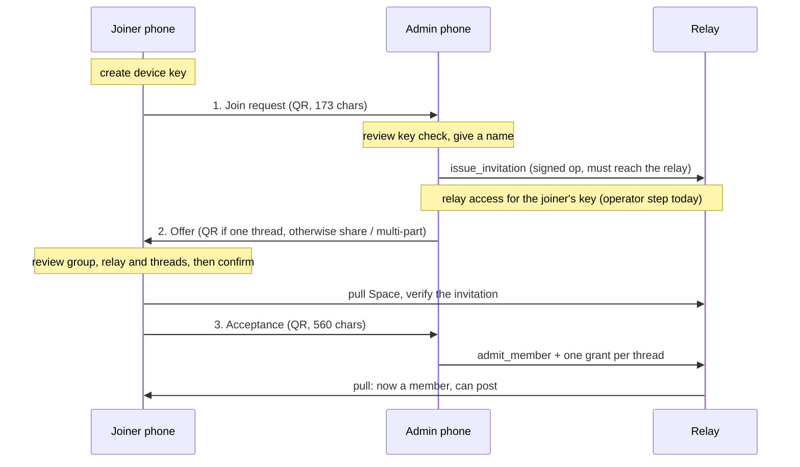

# 3. Application layer

The UI talks to one object, a `TreehouseSession`, and nothing else. A session is one device
identity in one Group. It exposes **read models** to subscribe to and **commands** that return
typed outcomes. Everything below it is reached through ports.

## Layers

```
screens / components          React Native. No lattice-client imports.
        │  subscribe(readModel)      │  await command()
        ▼                            ▼
TreehouseSession              pure TypeScript, runs under Node in tests
   ├─ projections             held ops + link state + local facts  ->  read models
   ├─ commands                check ability -> author -> save -> nudge sync
   └─ ceremony                invite / join saga
        │
        ▼ ports
KeyCustody · ReplicaStore · LocalStore · RelayLink · Clock · Handoff
        │
        ▼ adapters
expo-secure-store · expo-sqlite · shell-kit feed · camera / share sheet   (memory fakes in tests)
```

Dependency rule: each layer imports only the one below it. Adapters are the only files that
import Expo or React Native modules, so the session and everything above the ports runs in
plain Node. That is what makes the Core evidence tier cheap.

## Ports

| Port | Purpose | Methods (shape, not final names) |
|---|---|---|
| `KeyCustody` | hold the device key and per-Thread root keys | `status()`, `publicKey()`, `create()`, `sign(bytes)`, `createThreadKey(nonce)`, `threadPublicKey(nonce)`, `signThread(nonce, bytes)` |
| `ReplicaStore` | held frames per replica | `open()`, `appendAuthored(replica, frame)`, `mergeSync(replica, frames, ackedIds)`, `profile(replica)`, `replicas()`, `firstSeenMs(replica, id)` |
| `LocalStore` | device-local facts | petnames, drafts, read markers, ceremonies, routes, settings |
| `RelayLink` | sync and availability | thin wrapper over shell-kit `createFeedController`, `syncRoutes` |
| `Clock` | local time | `now()`; used for first-seen times only |
| `Handoff` | move artifacts between phones | `showQr(text)`, `scan()`, `share(text)`, `incomingLinks()` |

`ReplicaStore` and `LocalStore` are separate on purpose (see the three kinds of facts in
[02](02-domain-and-contexts.md)). `ReplicaStore.mergeSync` is the only path by which pulled
frames enter, and it is called only by shell-kit after verification.

## Read models

All read models are plain immutable objects. They are recomputed once per change of their
inputs and cached, never per render. The session exposes `subscribe(selector, listener)` so a
screen re-renders only when its slice changes (in React: `useSyncExternalStore`).

| Read model | Fields | Inputs |
|---|---|---|
| `SessionStatus` | `phase`: `no_key` \| `key_only` \| `joining` \| `member` \| `removed` \| `identity_mismatch` \| `history_invalid` | custody, store, Space view |
| `GroupSummary` | name, member count, my role, thread slots used and total, initialization | Space ops |
| `LinkStatus` | overall state, per-route state, total waiting to send, last successful sync (local time) | feed state |
| `ThreadList` | per thread: title, archived, last message preview and author (with the author's petname, M1b.1), unread count, waiting count, link state, route-not-connected mark (M1b.1) | Space + Thread ops, read markers, petnames, feed state |
| `ThreadTimeline` | ordered `MessageView[]`, archived flag, unread count, `unmarked` ids to mark as shown (M1b.4), thread health (ops, bytes vs rollover thresholds) | Thread ops, store, feed state, local facts |
| `Drafts` (M1b.2) | per held thread with a saved draft: its `Draft` (text, optional edit target) | LocalStore drafts |
| `MessageView` | id, lineage ref, author contact, text, edited flag, removed (`by_author` \| `by_moderator` \| none), mine, `delivery`, `standing`, first-seen time, arrived-late flag | all three kinds |
| `Roster` | per member: contact, role, is-root, relay access state if known, removal pending | Space ops, contacts |
| `Abilities` | per command: `{allowed: true}` or `{allowed: false, reason}` | judge, custody |
| `InvitationDesk` | outstanding invitations, ceremonies in progress and their step | Space ops, ceremonies |
| `AuditView` | per replica: op count, quarantined ops with reasons, grants and their state, frontier, relay generation, matches-relay | everything, unfiltered |

### Message state: two axes

`delivery` comes from the relay link and applies only to my own messages:

| `delivery` | Derived from | Label |
|---|---|---|
| `saved` | in outbox, not acked, link not live | Saved on this phone |
| `sending` | in outbox, not acked, link live | Sending |
| `on_relay` | acked | On relay |
| `relay_refused` | id in the route's `refused` list | Relay did not accept |
| `stopped` | route `submitStopped` is `unavailable` or `read_only` | Relay is not accepting messages |

`standing` comes from the local judge and applies to every message:

| `standing` | Meaning | Shown |
|---|---|---|
| `honored` | counts in the Group | normal bubble |
| `not_counted` | quarantined (reason from the judge or one of the six application denials) | only mine, greyed, with the reason; other people's appear in Verify only |

`relay_refused` is not durable: shell-kit reports it for the last sync only and clears it on
restart, after which the message shows as `saved` again. If durable refusal matters for the UI,
that is a shell-kit change (open decision O-6). There is no state for "delivered to a person".

### Connection state

Per route, shell-kit gives `idle`, `connecting`, `live`, `reconnecting`, `refused`. The Group
pill reduces them, with the Space route as the anchor:

| Pill | When |
|---|---|
| **Live** | every route `live` |
| **Connecting** | any route `connecting`, none failed |
| **Reconnecting** | any route `reconnecting` |
| **Partly connected** | Space `live`, some Thread route not |
| **Relay refused this phone** | Space route `refused` (wrong relay key or no relay access) |
| **Offline** | the person turned sync off, or the app has no network |

The rows overlap (Space live with a Thread reconnecting, for example), so the pill takes the first
match in this order (M1a.4): Offline (sync off, nothing configured, or every route idle), Relay
refused this phone, Reconnecting, Live, Partly connected, Connecting.

`· N waiting` is appended whenever the outbox has unacked ids. `matchesRelay` means "this
phone holds what the relay advertises". It never means every member has it.

### Order, time and unread

- Timeline order is the reducer's canonical order. The app never re-sorts.
- A message that this phone first held after the person last viewed the thread, but that sorts
  above the last message they saw, gets `arrivedLate`. The timeline shows a small "arrived
  later" mark and the thread counts it as unread.
- `LocalStore` keeps read ids, not a viewed time, so M1a.4 decides `arrivedLate` by position: an
  unread message that sorts above some message in the read set.
- Unread is "ids in the timeline not in the read marker". It is not a position. My own messages,
  removed placeholders and not-counted posts are never unread.
- A removed message keeps its place as a placeholder with no text. My own not-counted posts follow
  the counted timeline in the judge's canonical order (M1a.4).
- First-seen time is owned by `ReplicaStore` (`firstSeenMs(replica, id)`), written in the same
  transaction that first retains (or authors) a frame; `LocalStore` does not hold it.
  It labels day separators and message details. It is device-local and absent after a
  reinstall, in which case no time is shown.
- Unread counts move only while the app is in the foreground. Notifications and background
  delivery are beta exclusions.

## Commands

Every command follows one pipeline and returns `{ok: true, ...}` or `{ok: false, reason}`.
Nothing throws for an expected refusal.

```
1. ability check      same snapshot the button used
2. author             lattice-client helper: pick grant, deps = frontier, sign
3. pre-judge          reduce log + candidate; refuse if it would be quarantined
4. save               ReplicaStore.appendAuthored (frame + outbox, one transaction)
5. publish            read models update (message appears as saved / sending)
6. nudge              RelayLink.syncNow() if online; never awaited by the UI
```

| Command | Product | Upstream call | Needs |
|---|---|---|---|
| `postMessage(thread, text)` | Thread | `authorTreehouseCommand` `post` | member grant |
| `editMessage(ref, text)` | Thread | `author_edit` | author of the root post |
| `deleteMessage(ref)` | Thread | `author_tombstone` | author of the root post |
| `removeMessage(ref)` | Thread | `moderator_tombstone` | moderator holder |
| `archiveThread(thread)` | Thread | `archive_thread` | moderator holder |
| `createThread(title)` | Space + new Thread | `prepareTreehouseBoundedThreadCreation` | live root grant on the Space (the Tauri shell requires the root holder, not just any admin); a new Thread key; relay provisioning (gap) |
| `beginInvitation(joinRequest)` | Space | `authorTreehouseIssueInvitation` | admin; relay access for the joiner (gap) |
| `revokeInvitation(id)` | Space | `revoke_invitation` | admin |
| `admit(acceptance)` | Space + Threads | `authorTreehouseAdmitAndGrant` with `threadSigners` | `admit_member` grant; for each bounded Thread in scope, that Thread's key on this phone (else `thread_key_unavailable`) |
| `removeMember(key)` | Space + Threads | `remove_member`, `authorTreehouseGrantRevocation` | admin; relay admission removal (gap) |
| `changeModerator(key)` | Space and every Thread | `authorTreehouseRoleTransfer`, once per replica | current moderator holder of each replica |
| `transferAdmin(key)` | Space | `authorTreehouseRoleTransfer` | admin holder |
| `createGroup(name)` | new Space | `prepareTreehouseBoundedSpaceCreation` | relay provisioning (gap) |
| `setPetname`, `saveDraft`, `markRead` | local | none | nothing; local only, no op |
| `goOnline`, `goOffline`, `syncNow` | link | shell-kit | |

Refusal reasons are a closed union per command. They include the judge's quarantine reasons,
the six pinned application denials (`missing or not-causal target`, `quarantined target`,
`wrong target kind or thread`, `wrong author`, `already tombstoned`, `archived thread`), and
app-level reasons (`identity_unavailable`, `no_capability`, `empty_text`, `text_too_long`,
`malformed_text` (a lone UTF-16 surrogate, which lattice-client will not sign), `thread_slots_full`,
`storage_failed`). Each reason has exactly one line of copy in the
strings table; a missing mapping fails typecheck.

Decisions recorded for M1a.5:

- Thread commands take the Thread first, as `postMessage` does: `editMessage(thread, ref, text)`,
  `deleteMessage(thread, ref)`, `removeMessage(thread, ref)`, where `ref` is the timeline's
  `MessageLineage` (`{root, latest}`). Only `ref.root` is trusted. The target is the latest
  edit in the lineage as the held timeline shows it, so a stale `ref.latest` cannot fork the
  lineage. A root the timeline does not show is passed to the judge unchanged, and the judge
  names the denial.
- There is no app-side archive or target check before signing for these commands. The
  pre-judge returns the judge's reason. A moderator remove still counts after an archive.
- Local commands refuse `storage_failed`, or `not_open` before the session opens. Link
  commands add `history_invalid` (held history that failed its check never goes online) and
  `link_failed` (the link threw, as opposed to a route state). `syncNow` while sync is off
  dials nothing and returns the idle state.
- The archived banner says "Archived. No new messages." because 01 never uses "read", so 04's
  "Read only." is not used.

Decisions recorded in the M1a.4-M1a.5 review fix round:

- `Ability` holds no app list of which commands an archive blocks. After the delegation match and
  the holder check, abilities ask lattice-client's `treehouseCommandOpStatus` about a probe op of
  the command by this key, targeting a probe post of this key's own, and report only
  `application_archived_thread`. The delegation match (audience, ops, roles over
  `liveTreehouseDelegations`) is the filter `memberCapability` applies, as the Tauri shell's
  snapshot composes it; a Core test pins it to `memberCapability` for every key and command at every
  prefix of the four vectors. `postMessage` has no app-side archive check either: the pre-judge
  names "archived thread" after the capability check.
- A message's `delivery` is the least delivered of my ops in its lineage: the root post, the
  winning edit and my deletes (order: relay refused, stopped, saved, sending, on relay). An unsent
  or refused edit or delete of an acknowledged post is not "on relay". `edited` is false on a
  removed placeholder.
- `identity_mismatch` stops signing and transport (02 Invariant 8). With `outbox_other_key`,
  signed commands refuse `identity_mismatch`; with the key missing or locked they refuse
  `identity_unavailable`; `goOnline` and `syncNow` refuse `identity_mismatch` for every reason.
  Custody `unavailable` is `identity_mismatch` (`key_unavailable`) even with nothing held, so a
  locked key is never routed to key creation. A key that the held Space neither admits nor invites,
  with no outbox of another key, stays `key_only`: the outbox keeps every authored id, so a key
  change on a phone that ever authored shows as `outbox_other_key`.
- `LocalStore` is a required session port. A caller with no persistent store passes an explicitly
  in-memory one (the M0 screen does until M1a.7).
- `lastSyncMs` is stamped when every route is live and has compared with the relay, and either a
  route's relay result moved or a `syncNow` just completed.
- `GroupSummary.threadSlots.total` is the contract's 12 Threads per Space; `inviteScopeCap`
  reports `TREEHOUSE_LITE_THREAD_CAP` (3) separately. A Thread with no frames yet is not a Roster
  moderator mismatch.

Moderator authority is held per replica: the Space and each Thread have their own holder. The
UI presents one Group moderator, so `changeModerator` writes one transfer per replica and
`Roster` reports a mismatch if they diverge.

Multi-op commands (`createGroup`, `createThread`, `admit`, `removeMember`, `changeModerator`) are sagas: each
saves an intent before the first signature and is resumable. Upstream already supports retry
for creation (the same root and signed command are reused) and for admit (parts already present
are skipped).

## Enrollment ceremony

A saved state machine on each phone. Each step is durable before the next artifact is shown.



| Side | States |
|---|---|
| Joiner | `key_ready` → `request_shown` → `offer_reviewed` (memory) → `routes_saved` → `invitation_verified` → `acceptance_shown` → `admitted` → `ready` |
| Admin | `request_scanned` → `invitation_saved` → `invitation_on_relay` → `offer_shown` → `acceptance_scanned` → `admission_saved` → `admission_on_relay` |

Failure exits, each with one line of copy: `wrong_recipient`, `revoked`, `stale_scope` (a
thread was added since the invitation; issue a new one), `offer_scope_mismatch`,
`invitation_not_found` (the joiner cannot see the Space yet), `member_removed`,
`grant_revoked`, `grant_expired`, `invalid_acceptance`, plus the artifact errors
(`wrong_product`, `unsupported_artifact_version`, `artifact_too_large`, `secret_field`).

Facts that constrain the UX (measured 2026-11-25 with the real encoders):

- Three hand-offs, alternating direction. It cannot be two without a new signed command by
  which a non-member submits an acceptance; the vocabulary is frozen.
- The offer is about 1,490 chars with one thread, 2,700 with three and 8,150 with twelve
  (encoded with the live demo's route shapes). One dense QR holds about 2,900 bytes. So:
  single QR for one thread, and share sheet or multi-part QR beyond that (open decision O-4).
- The joiner signs the acceptance only after reviewing the invitation in Space frames it
  holds. So the admin's invitation must be on the relay, and the joiner must have relay
  access, before hand-off 3. The admin cannot run the whole ceremony offline. The offline
  bundle path (`treehouse_offline_enrollment`, up to 2 MiB) avoids this with a file hand-off.
- The admin assigns the joiner's transport realm; it travels in the offer as `localRealm`.
- If a Thread in scope is bounded and its key is on another phone, this phone cannot grant it
  and admission stops with `thread_key_unavailable`.
- `authorTreehouseAdmitAndGrant` admits at the `member` level only.
- Invitation scope is capped at 3 threads (`TREEHOUSE_LITE_THREAD_CAP`) while the contract
  allows 12 per Space. A Group with more than 3 threads cannot invite until that is lifted.

## Lifecycle

| Event | Session does |
|---|---|
| Launch | open custody, open stores, verify held replicas, publish `SessionStatus`, start the feed if sync is on |
| Foreground | start the feed, `syncNow()` |
| Background | stop the feed and close sockets. No background work. |
| Network lost | feed reports `reconnecting`; commands still save locally |
| Verify failure on launch | `history_invalid`; offer export of held frames; never auto-delete |
| Key missing with history present | `identity_mismatch`; never auto-create a key |

### Decisions recorded at M1a.7

- **Composition root.** `src/composition.tsx` wires the real adapters and is the only file that
  reaches `src/demo`. `index.ts` stays the entry (`main`): it installs the polyfills and then
  imports `expo-router/entry`, the SDK 58 custom-entry form.
- **Store files.** `LocalStore` setting `replicaStoreEpochs` holds one epoch per public key; the
  replica store for epoch 0 keeps M1a.2's file name, and epoch N > 0 adds the suffix `_r<N>`
  (`replicaStoreName`). A confirmed re-sync records epoch N+1 and opens that file; it never
  touches the failed one.
- **Carry-over.** The M0 snapshot outbox is carried into the epoch-0 store only. A carry-over that
  fails its check blocks the session as `history_invalid` through `SessionPorts.blockedHistory`,
  with reason `carry_over: ...`. Replicas that fail adoption are listed in
  `AppSession.adoptFailed` and shown as a notice.
- **Lifecycle.** `session.foreground()` and `background()` start and stop the feed and never write
  the person's `syncEnabled` setting. Installing a new session calls the lifecycle `reconcile()`,
  so a session that opened while the app was in the background does not keep its sockets.
- **Export.** `exportSpaceFrames()` returns the D-31 JSON text or `ExportRefusal`
  (`no_space`, `export_failed`); the app hands it to the share sheet (see 04, Group tab).
- **Self-check.** The dev self-check reports `backend: sqlite | none`; no memory fallback exists.

### Decisions recorded at M1b.1

- `ThreadListItem.last.authorPetname` carries the author's petname, so screens only format names:
  "You" for this phone's key, else the petname, else "Key check" and the fingerprint. The
  transport realm is never shown (01), and the demo bootstrap no longer passes realm names.
- `ThreadListItem.routeNotConnected` is 04's quiet mark: some route is live but this thread's
  route is not live (or none is configured). With the link off or every route idle the pill
  already says Offline, so no row is marked.
- The read marker is written by the thread screen: while it is open it marks every id the
  timeline reports as unread, so the Threads tab count clears on open. The unread divider (M1b.4)
  must take the first unread id before that write. (Since M1b.4 it marks `unmarked`, which adds my
  own messages; see below.)

### Decisions recorded at M1b.2

- `ReadModels.drafts` holds the saved draft per held thread. It is its own field, not part of
  `ThreadTimeline`, so saving a draft never rebuilds a timeline. The thread screen's composer
  keeps keystrokes in component state, saves through `saveDraft` after a 400 ms pause and when
  the input loses focus or the screen closes, fills itself from the stored draft once (never over
  typed text), and clears the draft after a post the session accepts. A save that fails is not
  remembered as saved, so it is written again. Edit drafts (`editOf`) are not written yet (M1b.3).
- `SessionStatus.reason` stays `string | null`; for `identity_mismatch` its values are listed as
  `IDENTITY_MISMATCH_REASONS` (`key_unavailable`, `key_missing`, `outbox_other_key`), and the copy
  is keyed by that closed list. The problem card says which in words and no longer prints the code
  (an unknown reason falls back to the phase line). `history_invalid` keeps its reason code.
- Message author names on the thread screen come from the `Roster`'s petnames through the same
  "You", petname, key check rule as M1b.1.

### Decisions recorded at M1b.4

- The read marker holds every id the thread screen has shown, my own messages included (01: "the
  set of message ids this phone has shown"). `ThreadTimeline.unmarked` lists the counted messages
  (placeholders included, my not-counted posts excluded) whose ids are not in the marker, in
  timeline order, and the screen marks exactly those. Without this, a post that arrives after I
  posted while paused has only my own messages below it and would never be `arrivedLate`.
- `arrivedLate` still needs an id in the read marker below it, so my own history held under an
  empty marker (reinstall, re-sync into `_r<N>`, demo role switch) marks nothing arrived later.
- Writing the marker clears `unread`, and with it `arrivedLate`, on the next timeline. So the
  screen holds both from the timeline it saw before that write (`createOpenMarks` in
  `src/ui/thread_view.ts`): the unread divider is taken once, above the first unread id with the
  count on open, and does not move; the arrived-later ids only grow while the screen is open, so a
  post arriving late while it is open is captioned too. Both reset when the screen opens again.

## Testing by tier

| Tier | Runs | Proves |
|---|---|---|
| **Core** | Node, memory adapters, fake relay or the live demo relay | session logic, read models, ceremony, every refusal reason |
| **Simulator** | iOS Simulator or Android Emulator, real SecureStore and SQLite | adapters, lifecycle, navigation, keyboard |
| **Physical** | real phones over `wss://` | camera, Keychain or Keystore behaviour, radio loss, two-device ceremony |

Each acceptance check compares against `Lattice.Sim` where a Sim scenario exists; the app is
never its own oracle.
